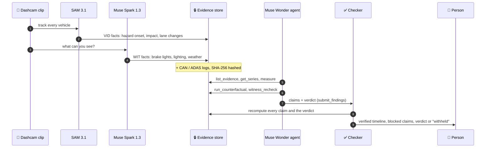
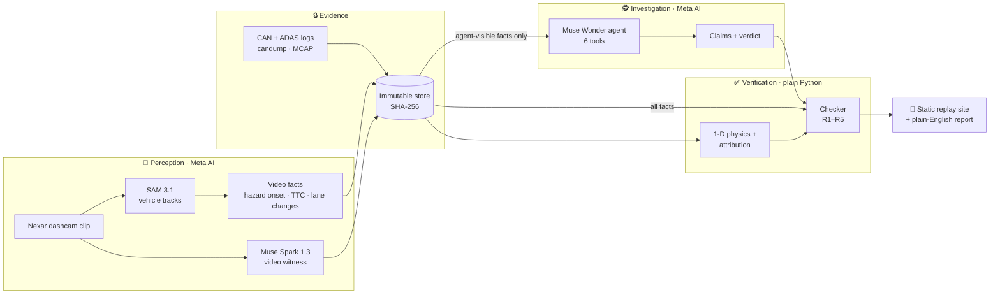

<div align="center">

# 🚦 Telltale

### Meta AI investigates vehicle crashes. A deterministic checker makes the investigation auditable.

*Real dashcam footage in, a verified incident timeline out. Meta AI watches the crash, an agent works out which part
of the car's driver-assist failed, and plain code recomputes every claim it makes before a person reads a word.*

<br>

**🔗 [Open the live replay](https://huggingface.co/spaces/Allen05254/telltale)** · no sign-in, no API key

<br>

[](https://dev.meta.ai/events/global-hackathon)
[](https://huggingface.co/spaces/Allen05254/telltale)
[](https://github.com/allenvarghese05/telltale/actions/workflows/ci.yml)

<br>


</div>

---

> ### 🧭 In one sentence
> When a car with driver-assist crashes, someone has to say whether the car noticed the hazard late, braked late,
> or never had a chance. Telltale lets **Meta AI do that investigation**, then **proves or blocks every statement
> it makes** with deterministic code, so the report a person signs off on contains nothing the evidence cannot back.

---

## 📖 Table of Contents

- [The Problem](#-the-problem)
- [What Telltale Does](#-what-telltale-does)
- [How One Case Runs](#-how-one-case-runs)
- [System Architecture](#-system-architecture)
- [The Checker: Five Rules and a Verdict](#-the-checker-five-rules-and-a-verdict)
- [Results](#-results)
- [Data Honesty](#-data-honesty)
- [Run It](#-run-it)
- [Tech Stack](#-tech-stack)
- [Project Structure](#-project-structure)
- [Security by Design](#-security-by-design)
- [Scope, Limits and What's Next](#-scope-limits-and-whats-next)
- [How It Was Built](#-how-it-was-built)

---

## 🎯 The Problem

Driver-assist and automated driving are on millions of cars, and they crash. After every crash, the same question
comes up: **did the system fail, and which part?**

- Did it **notice** the hazard too late?
- Did it notice in time, but **command** the brakes too late?
- Did the **brakes** themselves build pressure too slowly?
- Did it **hand control back** to the driver with no time left?
- Or was the crash **unavoidable** no matter what it did?

Answering that today means an engineer lining up dashcam frames against CAN logs by hand, for days per incident.
Language models could do the reading, but they state things that are not true. Meta's evaluation report for Muse
Spark 1.1 scored its input hallucination at 1.67 in a Petri 3.0 alignment run, against 1.22 for GPT-5.5 and 1.34
for Claude 4.8 Opus, where lower is better ([quoted here](https://www.eesel.ai/blog/meta-muse-spark-11-review)).
In October 2026 a Muse agent messaged a user, unprompted, that it could not check his Gmail for "that Anthropic
message". He had never asked, and Gmail was never connected
([report](https://futurism.com/artificial-intelligence/man-quits-meta-muse-creepy)).

> *A crash report cannot carry statements like that.*

**Telltale's answer is architectural, not a promise about the model:** the agent genuinely decides, and code proves
or blocks every statement before a person sees it.

---

## ✨ What Telltale Does

| Capability | Description |
|---|---|
| 🎥 **Video evidence from real crashes** | SAM 3.1 tracks every vehicle in real Nexar dashcam footage and timestamps the moment the struck vehicle became a hazard: it cut into the lane, was about to, or was already in the lane and closing. |
| 👁️ **An independent AI witness** | Muse Spark 1.3 watches the same clip and reports brake lights, turn signals, lighting, weather and road surface, and can be asked for a second look at a specific window. |
| 🕵️ **An agent that decides the cause** | A Muse Wonder agent reads the car's CAN and ADAS logs through six tools, runs but-for crash simulations, and names the primary cause. It never does arithmetic itself: every number comes from a tool. |
| ✅ **A checker that recomputes everything** | Plain Python recomputes every claim from the evidence and independently recomputes the verdict. Unproven claims are **blocked**. A verdict that disagrees is **withheld for human review**. |
| 🗣️ **Plain-English report, written by code** | The incident narrative a person reads is generated deterministically from verified facts, never by a language model. |
| 🔁 **A replay anyone can open** | A static site replays every case: the footage, the tracked vehicles, the logs, the agent's claims with their checker status, and the verdict. |
| 🚗🚛 **Car and truck profiles** | Separate braking physics and tolerances for a passenger car and a laden Class 8 tractor-trailer with air brakes. |

---

## 🔬 How One Case Runs



**What the agent can and cannot see.** The agent reads the video facts, the witness, the logs and the vehicle
profile. It never sees the checker's own physics facts (`PHYS:*`) or the deterministic attribution (`ATTR:*`).
It can only add facts through our tools: a witness recheck (`WIT2:*`) or a counterfactual run (`CF:*`). The
evidence store is immutable and hashed with SHA-256.

**What "1.06 s past its limit" means.** The agent measures each step of the car's response against its
tolerance:

| Step | Measured from | To | Car tolerance |
|---|---|---|---|
| 👀 **Perception** | danger appears (video) | driver-assist first tracks it (ADAS log) | 0.30 s |
| 🧠 **Command** | first tracked | brake commanded (ADAS log) | 0.10 s |
| 🛑 **Actuation** | brake commanded | pressure reached (CAN log) | 0.25 s (0.45 s truck) |
| 🙋 **Handoff** | control handed back | impact | a person needs about 1.5 s |

The step with the largest overrun is the primary cause, **unless** a but-for simulation with nominal latencies
still collides. Then the crash was **unavoidable**. If the logs have a gap, the answer is **inconclusive**.

---

## 🏗️ System Architecture



---

## ✅ The Checker: Five Rules and a Verdict

Every claim the agent submits carries its evidence IDs and a machine-checkable assertion, for example
`{"op": "diff", "a": "AV:first_seen_t", "b": "VID:hazard_onset_t", "equals": 1.36}`. The checker in
[`telltale/verify/checker.py`](telltale/verify/checker.py) applies:

| Rule | What it enforces |
|---|---|
| **R1 · Evidence exists** | Every cited ID is in the store, and at least one is cited. |
| **R2 · It recomputes** | The assertion is recomputed from the store, using only the cited facts. |
| **R3 · Every number is licensed** | Every number in the prose matches a supported number, allowing ms, km/h and mph conversions. |
| **R4 · No legal or driver-state claims** | No fault, blame or liability language, and no claims about the driver without a driver-facing camera. |
| **R5 · Two sources for what was seen** | A visual observation needs an independent second source, or it is labelled single-source. |
| **Verdict** | The checker recomputes the primary cause on its own. If it disagrees with the agent, the verdict is withheld. |

> **A real catch.** In the agent benchmark, Muse Wonder wrote *"Witness lighting daylight agrees on independent
> recheck at 6-8 s."* The checker blocked it: **number 6 in the text is not supported by the cited evidence**.
> The recheck did run over 6–8 s, but that window was a tool argument, not a fact. A true statement the checker
> cannot prove does not reach a report.

> **A staged catch: the red-team case.** The replay includes one clearly labelled case, `cand36-redteam`. It is a
> copy of a real perception-late run in which one claim and the verdict were altered by hand, the way a careless or
> motivated investigator might write them. The agent's measured 1.10 s perception time became *"Perception took
> 0.25 s … below the 0.3 s perception threshold"*, and the verdict became "no fault found". The checker was not
> modified. It **blocked** the claim (*recomputed 1.102, claimed 0.25*) and **withheld** the verdict: *independent
> recomputation from the same evidence gives PERCEPTION_LATE; report withheld pending human review*. The red-team
> case always replays its altered run, even under `--live`, and is never presented as a natural agent output.

---

## 📊 Results

| Benchmark | Result |
|---|---|
| 🎯 **Danger onset vs Nexar's human labels**<br/>40 unseen clips, no per-clip tuning | Median absolute error **0.905 s** (middle half 0.545–1.387 s). **80% within 2 s**, 53% within 1 s. Onset found on 30 of 40 clips (75%). Spread of the signed error 1.947 s. |
| 🕵️ **Agent alone vs agent + checker**<br/>19 blind cases, run live | Muse Wonder's verdict was correct on **19 of 19**, and the independent recomputation agreed on all 19. Of **172 claims, 171 verified, 1 blocked, 0 single-source**. No wrong verdict was verified. |
| 🔁 **Demo cases on the replay site**<br/>16 cases, 4 real clips, run live | **16 of 16** verdicts correct and verified. Of **142 claims, 139 verified, 3 blocked, 0 single-source**. |
| 🧪 **Synthetic attribution consistency**<br/>6 failure stories × car and truck | **162 of 162** correct, every story 1.000. Every dropout case returned "inconclusive" and no other case did. |

<details>
<summary><b>How to read these numbers honestly</b></summary>

<br>

**Danger onset is the only row with an outside answer key.** Against thresholds fixed in
[`docs/benchmarks/a5-preregistration.md`](docs/benchmarks/a5-preregistration.md) *before* the numbers existed,
the 1.947 s spread puts the result in the **partially consistent** bucket, not the strong one. On average Telltale
fires 0.861 s earlier than the human annotator, mostly on dense urban traffic where a fixed 2 s time-to-collision
rule fires on ordinary car-following. The full analysis, including the five worst clips, is in
[`docs/benchmarks/a5-results.md`](docs/benchmarks/a5-results.md); the raw rows are in
[`video_bench.json`](video_bench.json). No threshold was tuned in response to them.

**What the checker blocked, and what changed.** An earlier run of the same 19 cases blocked 12 of 165 claims
(commit `280254d`). None of the 12 was false. Most stated a correct interval while citing only the timestamps it
came from; the rest tried to confirm the witness with a recheck tool that could only answer yes, no or unclear.
Both were fixed on the agent side, in its instructions and in the recheck tool (commit `2a23728`). **The checker
did not change between the two runs.** Every claim in [`agent_bench.json`](agent_bench.json) can be re-checked
offline from the committed runs.

**The 3 blocks on the demo site are not 3 falsehoods.** One is the same pattern as the benchmark catch: a recheck
"on 6.00-7.00 s window" whose window is not in the evidence (`cand36-car-s3775`). The other two, both in
`cand37-car-s1313`, state correct facts ("no contact", "brake log complete") but use a numeric check on a yes/no
fact, so the checker could not evaluate them. Those are form blocks: the content was right, the proof was not.

**This benchmark did not exercise catching a wrong verdict**, because the agent was right on all 19. That path is
covered by the test suite (`test_analyze_rejects_a_wrong_agent_verdict`, `test_verdict_verified_and_rejected`) and
shown in the labelled red-team case.

**The synthetic row checks consistency, not real-world accuracy.** It injects a fault and then measures that fault
against its threshold, so near-perfect accuracy is close to built in. It shows the deterministic engine agrees
with itself across two vehicle profiles and six failure modes. 30 combinations were not generated, all on clip
`cand63`: its 5.28 s between hazard and impact gives a braking vehicle time to stop, so the generator refused to
fabricate a collision. Raw rows: [`bench_results.json`](bench_results.json).

</details>

---

## 🧾 Data Honesty

| | |
|---|---|
| 🎥 **The video is real** | Every clip comes from the Nexar Collision Prediction Dataset, under the Nexar Open Data License ([`data/clips/NEXAR_LICENSE`](data/clips/NEXAR_LICENSE)). Attribution: Moura & Zvitia, "Nexar Collision Dataset", Hugging Face, 2025. No resale, and no re-identification of people, vehicles or plates. |
| 🧪 **The vehicle logs are synthetic** | Real fleet CAN and ADAS logs are proprietary, and we have no access to any. [`telltale/logs/generate.py`](telltale/logs/generate.py) generates logs that agree with each clip: it solves for the starting gap so the simulated crash lands on the video's real impact time, then injects faults at random only where a dashcam cannot see (when the driver-assist noticed, commanded, and how fast the brakes built pressure), with clock skew applied. **Swap in a real fleet's logs through a DBC file and nothing else changes.** |
| 🙈 **Ground truth stays hidden** | The fault each log was generated with lives under `data/ground_truth/`. Only benchmark scoring code reads it. The agent, the checker and the evidence builder never do. |
| 🌐 **Only public data reaches the Meta API** | Free-tier credits allow Meta to use submitted content, so nothing private is ever sent. |

---

## 🚀 Run It

### 1. Replay, no API key

Rebuilds the same static site the hosted Space serves, from the cached investigations in the repository.

```bash
python3.12 -m venv .venv && source .venv/bin/activate
pip install -e .
telltale export-site
telltale serve          # → http://127.0.0.1:8000
```

### 2. Re-investigate live, with your own key

```bash
cp env.example .env     # set MODEL_API_KEY; .env is never committed
telltale make-demo
telltale analyze-all --live
telltale export-site && telltale serve
```

Each live run is cached to `cache/`, and the checker verifies it the same way. Replay mode never makes a network call.

### 3. Any dashcam clip

SAM 3.1 runs through Meta's cookbook script, which is not vendored, so fetch it once:

```bash
git clone --depth 1 https://github.com/meta-models/meta-model-cookbook vendor/meta-model-cookbook
pip install -r vendor/meta-model-cookbook/07_sam/01_api_basics/requirements.txt

telltale add-clip my_dashcam.mp4 --clip-id mine --event-time 7.4
telltale sam mine
telltale witness mine
telltale video-report mine
```

`video-report` describes what the footage alone establishes: the vehicles tracked, when the struck one became a
hazard and how, its lane changes, and the witness's conditions. It makes no claim about cause, because that needs
the vehicle's own logs.

<details>
<summary><b>All CLI commands</b></summary>

<br>

| Command | What it does |
|---|---|
| `telltale fetch-list` / `fetch` | List Nexar crash clips, download and trim one |
| `telltale add-clip` | Register your own dashcam clip and its impact time |
| `telltale lane-preview` | Draw the ego-lane polygon on a frame |
| `telltale sam` | Track vehicles with SAM 3.1 (cached) |
| `telltale witness` | Ask Muse Spark 1.3 the witness questions (cached) |
| `telltale video-report` | Video-only incident report for any clip |
| `telltale video-bench` | Danger onset against Nexar's human labels |
| `telltale generate` / `make-demo` | Generate one synthetic-log case, or the demo set |
| `telltale analyze` / `analyze-all` | Run the agent and the checker on one or all cases |
| `telltale benchmark` | Synthetic blind attribution benchmark |
| `telltale agent-bench` | Agent alone vs agent + checker |
| `telltale export-site` / `serve` | Build and serve the static replay site |

</details>

---

## 🛠️ Tech Stack

<table>
<tr><td valign="top" width="50%">

### Meta AI
- **SAM 3.1**: vehicle tracking across every frame
- **Muse Spark 1.3**: video witness and targeted rechecks
- **Muse Wonder**: tool-using investigator agent
- All model calls cached; replay is fully offline

</td><td valign="top" width="50%">

### Deterministic core
- **Python 3.12**, frozen dataclasses, typed boundaries
- **NumPy / SciPy**: 1-D crash physics, but-for simulation
- **cantools** + **MCAP**: CAN (DBC) and ADAS logs
- **OpenCV**: video frames and lane previews

</td></tr>
<tr><td valign="top">

### Replay site
- Static HTML + vanilla JS, no server code
- **Plotly**: synchronized timelines
- Strict Content-Security-Policy, every string escaped
- Hosted on a **Hugging Face Static Space**

</td><td valign="top">

### Quality and security
- **pytest**: tests written first, no network in tests
- **ruff** (incl. bandit rules) + **vulture**: zero dead code
- **gitleaks**, **pip-audit**, **CodeQL**, Dependabot
- **GitHub Actions**: CI, then auto-deploy on `main`

</td></tr>
</table>

---

## 📁 Project Structure

```
telltale/
├── telltale/
│   ├── core/          # shared schema: facts, video facts, labels, manifest
│   ├── video/         # SAM tracks → lane geometry, TTC, hazard onset, witness, video report
│   ├── logs/          # synthetic CAN/ADAS log generator (candump + MCAP)
│   ├── evidence/      # immutable SHA-256 evidence store, clock alignment
│   ├── physics/       # 1-D braking sim, but-for counterfactual, attribution, car/truck profiles
│   ├── agent/         # Muse Wonder investigator and its six tools
│   ├── verify/        # the checker: rules R1–R5 and the independent verdict
│   ├── pipeline/      # analyze, demo cases, agent benchmark
│   ├── web/           # static-site exporter, deterministic narrative, replay UI
│   └── cli.py         # `telltale ...`
├── data/              # Nexar clips + license, demo cases, hidden ground truth
├── cache/             # cached SAM, witness and agent runs (replay never calls the network)
├── docs/              # plans and pre-registered benchmark protocols
├── tests/             # pytest suite, mirrors the package
└── AGENTS.md          # engineering rules for every contributor and coding agent
```

---

## 🛡️ Security by Design

- 🔑 **API keys live only in `.env`**: never logged, committed, or shipped. The hosted Space has no key at all.
- 🧱 **Model output is data, never instructions**: parsed defensively, enums validated, unknown evidence IDs rejected.
- 🙈 **The agent is contained**: it cannot read the checker's facts and can only append facts through our tools.
- 🔒 **Evidence is immutable**: the store is hashed with SHA-256.
- 🌐 **The site is static**: no endpoints, case IDs validated before they become paths, every string HTML-escaped.
- 🔍 **Supply chain**: gitleaks on full history, pip-audit, CodeQL for Python and JavaScript, dependency review.

---

## 🧭 Scope, Limits and What's Next

**Full attribution covers forward conflicts: rear-end and cut-in crashes.** The crash physics is one-dimensional.
Cross-path crashes, like the intersection U-turn in clip `cand60`, get the video-only report, which makes no claim
about cause.

**Telltale never decides legal responsibility.** It identifies which step of the car's response fell outside its
tolerance, and hands a person a verified timeline to sign off. The tolerances in
[`telltale/physics/profiles.py`](telltale/physics/profiles.py) are illustrative engineering values, not regulatory
limits.

**Next steps, each grounded in something measured during the build:**

- 📐 **2-D physics** for cross-path geometry, so crashes like `cand60` can be attributed too.
- 🚦 **A speed-aware hazard threshold.** The fixed 2 s time-to-collision rule fires on ordinary urban
  car-following, which is why Telltale fires early on city clips. On 8 of 40 benchmark clips no hazard test fired.
- 🔗 **Motion-based re-association** (ByteTrack / OC-SORT style) for long, occluded footage. On the four demo clips
  SAM 3.1 already held one identity for the struck vehicle in every frame, so this is for harder footage.
- 🔌 **A real-log adapter.** The pipeline reads logs through DBC files; a fleet supplies its own.

---

## 🧱 How It Was Built

Telltale was built solo during the **Meta Global AI Developer Hackathon** (October 26 – November 4, 2026). The work
ran as four parallel tracks in separate git worktrees (video evidence, vehicle logs and physics, the agent and
checker, and the replay site), each building against data formats locked on the first night. The plans are in
[`docs/plans/`](docs/plans/), and the rules every contributor and coding agent follows are in
[`AGENTS.md`](AGENTS.md).

<br>

<div align="center">

### Built by [Allen Varghese](https://github.com/allenvarghese05)

*Meta Global AI Developer Hackathon 2026 · Indie track*

<br>

### 🚦 *An AI investigator you can audit, one claim at a time.*

Video: [Nexar Collision Dataset](https://huggingface.co/datasets/nexar-ai/nexar_collision_prediction) (Nexar Open Data License)

</div>
