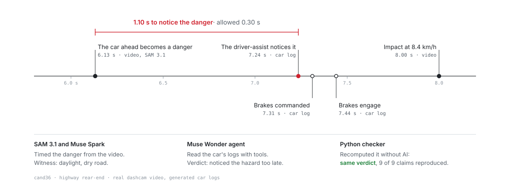

<div align="center">

# Telltale

### Meta AI investigates vehicle crashes. A deterministic checker makes the investigation auditable.

**[Live replay](https://huggingface.co/spaces/Allen05254/telltale)** (no sign-in, no API key)

<br>

[](https://dev.meta.ai/events/global-hackathon)
[](https://huggingface.co/spaces/Allen05254/telltale)
[](https://github.com/allenvarghese05/telltale/actions/workflows/ci.yml)

<br>


</div>

---

Telltale takes a real dashcam crash clip and the vehicle's own logs and works out which step of the car's
driver-assist response failed: noticing the hazard, commanding the brakes, or the brakes themselves. Meta AI does
the investigating. Plain Python recomputes every statement it makes, and the verdict, before a person reads any of
it.

## Contents

- [The problem](#the-problem)
- [What Telltale does](#what-telltale-does)
- [How one case runs](#how-one-case-runs)
- [Architecture](#architecture)
- [The physics and the math](#the-physics-and-the-math)
- [The checker](#the-checker)
- [Results](#results)
- [Findings from the build](#findings-from-the-build)
- [Data honesty](#data-honesty)
- [Run it](#run-it)
- [Tech stack](#tech-stack)
- [Project structure](#project-structure)
- [Security](#security)
- [Scope, limits and next steps](#scope-limits-and-next-steps)
- [How it was built](#how-it-was-built)

---

## The problem

When a car with driver-assist crashes, someone has to work out what the system did. Did it notice the hazard too
late? Did it notice in time but command the brakes too late? Did the brakes build pressure too slowly? Did it hand
control back to the driver with no time left? Or would the crash have happened whatever it did?

Today that means an engineer lining up dashcam frames against CAN logs by hand. Language models could do the
reading, but they state things that are not true. Meta's evaluation report for Muse Spark 1.1 scored its input
hallucination at 1.67 in a Petri 3.0 alignment run, against 1.22 for GPT-5.5 and 1.34 for Claude 4.8 Opus, where
lower is better ([quoted here](https://www.eesel.ai/blog/meta-muse-spark-11-review)). In October 2026 a Muse agent
messaged a user, unprompted, that it could not check his Gmail for "that Anthropic message". He had never asked,
and Gmail was never connected ([report](https://futurism.com/artificial-intelligence/man-quits-meta-muse-creepy)).

A crash report cannot contain statements like that. Telltale lets the agent make the decision, and requires code to
reproduce every statement before it reaches a person.

---

## What Telltale does

| Part | What it does |
|---|---|
| Video evidence | SAM 3.1 tracks every vehicle in real Nexar dashcam footage. Deterministic code turns the tracks into lane positions, time to collision and the moment the struck vehicle became a hazard. |
| Video witness | Muse Spark 1.3 watches the same clip and reports brake lights, turn signals, lighting, weather and road surface. The agent can ask it for a second look at a specific time window. |
| Investigator | A Muse Wonder agent reads the car's CAN and ADAS logs through six tools, runs but-for crash simulations and names the primary cause. Every number it uses comes from a tool. |
| Checker | Plain Python recomputes each claim from the evidence and recomputes the verdict independently. A claim it cannot reproduce is blocked. A verdict that disagrees is withheld for human review. |
| Report | The plain-English incident narrative is generated by code from verified facts, not by a language model. |
| Replay site | A static site shows each case: the footage, the tracks, the logs, every claim with its checker status, and the verdict. |
| Vehicle profiles | A passenger car and a laden Class 8 tractor-trailer with air brakes, each with its own braking physics and tolerances. |

---

## How one case runs

<p align="center"></p>

<sub>Diagram source: [`docs/diagrams/how-one-case-runs.mmd`](docs/diagrams/how-one-case-runs.mmd)</sub>

The agent reads the video facts, the witness answers, the logs and the vehicle profile. It never sees the
checker's physics facts (`PHYS:*`) or the deterministic attribution (`ATTR:*`). It can add facts only through two
tools: a witness recheck (`WIT2:*`) and a counterfactual run (`CF:*`). The evidence store is immutable and hashed
with SHA-256.

---

## Architecture

<p align="center"></p>

<sub>Diagram source: [`docs/diagrams/architecture.mmd`](docs/diagrams/architecture.mmd)</sub>

---

## The physics and the math

Everything in this section is deterministic code. No model computes any of it.

### 1. Where a vehicle is in the lane

Each SAM box is reduced to its bottom-centre point $(x_c, y_b)$. The ego-lane edges are lines in the image, so at
the box's own depth $y_b$ the lane spans $x_L(y_b)$ to $x_R(y_b)$. Lane position is measured in lane widths:

```math
u = \frac{x_c - x_L(y_b)}{x_R(y_b) - x_L(y_b)}
```

$u = 0$ is the left edge, $u = 1$ the right edge, and values outside $[0, 1]$ are outside the lane. Dividing by the
lane width at the vehicle's depth cancels perspective, so the same thresholds apply to a car 10 m away and one 60 m
away. Frames where the lane is narrower than 15% of its near width are dropped, because dividing by a few pixels
turns box jitter into huge offsets ([`telltale/video/motion.py`](telltale/video/motion.py)).

### 2. Is it really moving? A significance-tested slope

SAM box widths jitter by about 10 px from frame to frame, and a box occasionally merges with a neighbour for one
frame. A frame-to-frame derivative turns both into false motion. Every rate in Telltale is therefore a windowed
least-squares slope with a significance test ([`telltale/video/trend.py`](telltale/video/trend.py)):

1. Median-filter the series over 5 frames, which deletes single-frame spikes instead of smearing them.
2. Over a 15-frame window, fit a line:

```math
\hat\beta = \frac{\sum_i (t_i - \bar t)(y_i - \bar y)}{\sum_i (t_i - \bar t)^2}
```

3. Estimate the noise from the raw residuals $r_i$ with the median absolute deviation, so one outlier cannot inflate it:

```math
\hat\sigma = 1.4826 \cdot \mathrm{median}\big(\lvert r_i - \mathrm{median}(r)\rvert\big),
\qquad
\mathrm{SE}(\hat\beta) = \frac{\hat\sigma}{\sqrt{\sum_i (t_i - \bar t)^2}}
```

4. Report the slope as real only if $\lvert\hat\beta\rvert > 3 \cdot \mathrm{SE}(\hat\beta)$.

### 3. Time to collision from a single camera

A vehicle's apparent width $w$ is inversely proportional to its distance $Z$, so $w \propto 1/Z$ and
$\dot w / w = -\dot Z / Z$. Time to collision is distance over closing speed, which gives the scale-expansion
formula ([`telltale/video/ttc.py`](telltale/video/ttc.py)):

```math
\mathrm{TTC} = \frac{Z}{-\dot Z} = \frac{w}{\dot w}
```

$w$ is the fitted width and $\dot w$ the significant slope from step 2. If the slope is not significant, TTC is
infinite: the vehicle is not approaching.

### 4. When did the vehicle become a hazard?

Every tracked vehicle is tested three ways, and the earliest test to fire is the hazard onset
([`telltale/video/hazard.py`](telltale/video/hazard.py)):

| Reason | Fires when |
|---|---|
| `entering` | the vehicle crosses laterally into the ego lane |
| `predicted` | it is outside the lane but will reach the edge within 2 s, held for 9 frames |
| `closing` | it is at least half inside the lane and $\mathrm{TTC} < 2$ s, held for 9 frames |

For `predicted`, time to lane crossing uses the lateral rate $\dot u$ from step 2:

```math
\mathrm{TLC} =
\begin{cases}
\dfrac{u - 1}{-\dot u} & u > 1,\ \dot u < 0 \\[2ex]
\dfrac{-u}{\dot u} & u < 0,\ \dot u > 0 \\[1ex]
\infty & \text{otherwise}
\end{cases}
```

Each test also requires a finite TTC, so a car travelling alongside in the next lane never counts as a hazard.

### 5. Putting the logs on one clock

The CAN log, the ADAS log and the video each have their own clock. The CAN log is anchored to the video by the
impact trigger ($t_{\text{video}} = t_{\text{CAN}} + \Delta_{\text{CAN}}$). The ADAS log is then anchored to CAN by
matching its ego-speed trace to CAN wheel speed, with a grid search over $\pm 1.5$ s in 2 ms steps
([`telltale/evidence/align.py`](telltale/evidence/align.py)):

```math
\Delta_{\text{ADAS}} = \arg\min_{\delta} \; \frac{1}{N} \sum_{k} \big(v_{\text{CAN}}(t_k) - v_{\text{ADAS}}(t_k - \delta)\big)^2
```

### 6. The four latencies

With every timestamp in video seconds, and $t_0$ the video's hazard onset:

```math
\begin{aligned}
L_{\text{perception}} &= t_{\text{first seen}} - t_0 \\
L_{\text{command}}    &= t_{\text{brake request}} - t_{\text{first seen}} \\
L_{\text{actuation}}  &= t_{p \ge 0.6\,p_{\max}} - t_{\text{brake request}} \\
M_{\text{handoff}}    &= t_{\text{impact}} - t_{\text{handoff}}
\end{aligned}
```

### 7. Brakes and the crash simulation

Brake pressure, and with it deceleration, builds as a first-order lag from the brake request $t_r$
([`telltale/physics/sim.py`](telltale/physics/sim.py)):

```math
a(t) = a_{\max}\left(1 - e^{-(t - t_r)/\tau}\right), \qquad t \ge t_r
```

The time to reach 60% of full pressure is therefore $\tau \ln 2.5 \approx 0.916 \tau$. That is how a measured
actuation latency converts back to a time constant: $\hat\tau = L_{\text{actuation}} / \ln 2.5$.

The crash itself is one-dimensional. The ego car starts $d_0$ metres behind a lead vehicle moving at constant speed
$v_o$, and the simulation integrates with a 1 ms step:

```math
\dot v_e = -a(t), \quad v_e \ge 0, \qquad
g(t) = d_0 + v_o t - x_e(t), \qquad
\text{contact when } g(t) \le 0
```

The starting gap comes from the ADAS radar track: the range at first detection, plus how far the gap closed between
hazard onset and that detection, $d_0 = r_{\text{first seen}} + \Delta v \cdot L_{\text{perception}}$.

| Profile | $a_{\max}$ | nominal $\tau$ | Perception | Command | Actuation | Driver reaction |
|---|---|---|---|---|---|---|
| Car | 8.0 m/s² | 0.15 s | 0.30 s | 0.10 s | 0.25 s | 1.5 s |
| Truck (Class 8, air brakes) | 4.5 m/s² | 0.35 s | 0.30 s | 0.10 s | 0.45 s | 1.5 s |

These tolerances are illustrative engineering values, not regulatory limits
([`telltale/physics/profiles.py`](telltale/physics/profiles.py)).

### 8. Attribution: which step failed

Each step's excess over its tolerance $\theta$ is

```math
e_k = L_k - \theta_k \quad (k \in \{\text{perception}, \text{command}, \text{actuation}\}), \qquad
e_{\text{handoff}} = 1.5\,\text{s} - M_{\text{handoff}}
```

and the verdict follows a fixed order ([`telltale/physics/attribution.py`](telltale/physics/attribution.py)):

1. If the brake log has a gap longer than 0.1 s, the verdict is **INCONCLUSIVE**.
2. Re-run the crash with nominal behaviour (perception 0.20 s, command 0.05 s, nominal $\tau$). If it still
   collides, the verdict is **UNAVOIDABLE**, whatever was slow.
3. If no $e_k > 0$, the verdict is **NO_FAULT_FOUND**.
4. Otherwise the primary cause is $\arg\max_k e_k$: **PERCEPTION_LATE**, **COMMAND_LATE**,
   **BRAKE_ACTUATION_LATE** or **LATE_HANDOFF**.

So "1.06 s past its limit" on a perception-late case means $L_{\text{perception}} = 1.36$ s against
$\theta = 0.30$ s, with the other steps inside their tolerances.

### 9. Making synthetic logs agree with the real video

For each clip the video gives two real times: hazard onset $t_0$ and impact $t_{\text{imp}}$, so
$T = t_{\text{imp}} - t_0$. The generator ([`telltale/logs/generate.py`](telltale/logs/generate.py)):

1. draws hidden parameters at random for the chosen story, for example ego speed $v_e \sim U(18, 30)$ m/s and,
   for a perception-late case, a detection delay $\sim U(1.0, 1.6)$ s;
2. solves for the starting gap $d_0$ by bisection, 40 iterations, so that the simulated contact lands on the real
   impact: $\lvert t_{\text{contact}}(d_0) - T \rvert \le 0.03$ s;
3. accepts the draw only if the attribution above reaches the story's verdict, and applies independent clock skews
   of up to 0.5 s (CAN) and 0.8 s (ADAS).

Faults are only ever injected into what a dashcam cannot see: when the driver-assist noticed, when it commanded and
how fast pressure built.

### 10. Kinematic Limitations & v2 Formulation

#### v1 Baseline Kinematics: Longitudinal Deceleration Envelope & Reaction Latency Deficit

Everything in sections 7 to 9 is the v1 engine. The name describes its two halves:

- **Longitudinal deceleration envelope**: motion along the lane only, with the ego vehicle's braking bounded by
  $a_{\max}$ and reached through a first-order lag $\tau$ (section 7).
- **Reaction latency deficit**: each step's measured latency minus its tolerance, $e_k = L_k - \theta_k$, and the
  primary cause is the largest deficit that mattered in the but-for run (section 8).

Its assumptions, stated plainly:

| Assumption | Consequence |
|---|---|
| Motion along the lane only | Cross-path crashes (`cand60`) get the video-only report, no attribution |
| The target vehicle keeps a constant speed | Contact can never come sooner than the constant-speed time to collision |
| Fixed $a_{\max}$ and one lag $\tau$ per profile | No road grade, load or friction effects; no separate air-brake transport delay |
| Synthetic logs anchored to two video times (onset, impact) | The video's own time-to-collision estimate is not used by the generator |

The second assumption can be tested against the footage. Under v1, ego braking can only delay contact, so the time
from onset to impact must be at least the time to collision measured at onset:

```math
T = t_{\text{imp}} - t_0 \;\ge\; \mathrm{TTC}_0 \qquad \text{(v1, constant-speed target)}
```

On the three rear-end demo clips:

| Clip | $\mathrm{TTC}_0$ measured from the video | $T$, onset to impact | Consistent with v1? |
|---|---|---|---|
| `cand38` | 2.00 s | 2.10 s | yes |
| `cand36` | 1.94 s | 1.87 s | no, by 0.07 s |
| `cand37` | 1.92 s | 1.17 s | no, by 0.75 s |

On `cand37` the impact came 0.75 s sooner than constant speeds allow, so either the target vehicle was braking hard
or the TTC estimate at onset is off. That is why the generator does not yet use $\mathrm{TTC}_0$: forcing it into v1
would make `cand37` impossible to generate.

#### v2 Formulation (planned, not built)

Written for the truck profile; the car is identical with $v_{\text{car}}$ in place of $v_{\text{truck}}$.

**Dynamic relative velocity.** The target vehicle may decelerate, so the closing speed changes over time:

```math
v_{\text{target}}(t) = \max\left(v_{\text{target},0} - a_{\text{target}}\, t,\ 0\right), \qquad
\Delta v(t) = v_{\text{truck}}(t) - v_{\text{target}}(t)
```

**Dynamic gap closure.** The gap integrates the changing closing speed, and contact is its first zero:

```math
g(t) = d_0 - \int_0^t \Delta v(s)\, ds, \qquad t_{\text{contact}} = \min\{\, t : g(t) \le 0 \,\}
```

**Pneumatic pressure rise.** Air brakes add a transport delay $t_d$, while the brake signal and air travel down the
lines, before the pressure rise with time constant $\tau_{\text{air}}$. v1 folds both into one lag. v2 separates them:

```math
p(t) =
\begin{cases}
0 & t < t_r + t_d \\[1ex]
p_{\max}\left(1 - e^{-(t - t_r - t_d)/\tau_{\text{air}}}\right) & t \ge t_r + t_d
\end{cases}
\qquad
a_{\text{truck}}(t) = a_{\max}\,\frac{p(t)}{p_{\max}}
```

**Anchoring to three video measurements instead of two.**

```math
d_0 = \Delta v_0 \cdot \mathrm{TTC}_0, \qquad g(T) = 0
```

With the truck's trajectory fixed by the injected latencies and $\Delta v_0$ drawn at random as in v1, the target's
deceleration $a_{\text{target}} \ge 0$ is solved by bisection so that contact lands on the filmed impact. When the
footage allows it, with $`T \ge \mathrm{TTC}_0`$, the solution is $`a_{\text{target}} = 0`$ and v2 reduces to v1. Ignoring
ego braking, the required deceleration is roughly

```math
a_{\text{target}} \approx \frac{2\,\Delta v_0\,(\mathrm{TTC}_0 - T)}{T^2}
```

which for `cand37` is about 4.4 m/s² at $\Delta v_0 = 4$ m/s: a firm stop by the target vehicle, physically
plausible. Because $\mathrm{TTC}_0$ is itself an estimate, v2 should carry it as an interval rather than a point.
v2 is documented only: changing the generator regenerates every case, and the committed live runs were made on v1.

---

## The checker

Each claim carries its evidence IDs and a machine-checkable assertion, for example
`{"op": "diff", "a": "AV:first_seen_t", "b": "VID:hazard_onset_t", "equals": 1.36}`. Supported operations are
`value`, `diff`, `gt`, `lt`, `is`, `agree` and `same`. A number matches when

```math
\lvert x - y \rvert \le \max(0.05,\ 0.05\,\lvert y \rvert)
```

with unit conversions for milliseconds, km/h and mph. The rules in
[`telltale/verify/checker.py`](telltale/verify/checker.py):

| Rule | What it enforces |
|---|---|
| R1. Evidence exists | Every cited ID is in the store, and at least one is cited. |
| R2. It recomputes | The assertion is recomputed from the store using only the cited facts. |
| R3. Every number is licensed | Every number in the text matches the cited facts or the assertion. |
| R4. No legal or driver-state claims | No fault, blame or liability language, and no claims about the driver without a driver-facing camera. |
| R5. Two sources for what was seen | A visual observation needs an independent second source, or it is labelled single-source. |
| Verdict | The checker recomputes the primary cause itself. If it disagrees with the agent, the verdict is withheld. |

**A natural catch.** In the agent benchmark, Muse Wonder wrote "Witness lighting daylight agrees on independent
recheck at 6-8 s." The checker blocked it with "number 6 in the text is not supported by the cited evidence". The
recheck did run over 6 to 8 s, but that window was a tool argument, not a fact in the evidence. A true statement
the checker cannot reproduce does not reach the report.

**A staged catch.** The replay includes one labelled red-team case, `cand36-redteam`. It is a copy of a real
perception-late run with one claim and the verdict edited by hand. The measured 1.10 s perception time became
"Perception took 0.25 s ... below the 0.3 s perception threshold", and the verdict became "no fault found". With
the checker unchanged, it blocked the claim ("recomputed 1.102, claimed 0.25") and withheld the verdict
("independent recomputation from the same evidence gives PERCEPTION_LATE; report withheld pending human review").
The red-team case always replays its edited run, even with `--live`.

---

## Results

| Benchmark | Result |
|---|---|
| Danger onset vs Nexar's human labels (40 unseen clips, no per-clip tuning) | Median absolute error 0.905 s, middle half 0.545 to 1.387 s. 80% within 2 s, 53% within 1 s. Onset found on 30 of 40 clips. Spread of the signed error 1.947 s. |
| Agent alone vs agent plus checker (19 blind cases, run live) | Muse Wonder's verdict was correct on 19 of 19, and the independent recomputation agreed on all 19. Of 172 claims, 171 verified, 1 blocked, 0 single-source. No wrong verdict was verified. |
| Demo cases on the replay site (16 cases, 4 real clips, run live) | 16 of 16 verdicts correct and verified. Of 142 claims, 139 verified, 3 blocked, 0 single-source. |
| Synthetic attribution consistency (6 failure stories, car and truck) | 162 of 162 correct. Every dropout case returned INCONCLUSIVE and no other case did. |

**How to read these.**

- **Danger onset is the only benchmark with an outside answer key.** Against thresholds fixed in
  [`docs/benchmarks/a5-preregistration.md`](docs/benchmarks/a5-preregistration.md) before any numbers existed, the
  1.947 s spread falls in the "partially consistent" bucket, not the strong one. On average Telltale fires 0.861 s
  earlier than the human annotator. Full analysis, including the five worst clips:
  [`docs/benchmarks/a5-results.md`](docs/benchmarks/a5-results.md). Raw rows: [`video_bench.json`](video_bench.json).
  No threshold was tuned after seeing them.
- **The blocks are not falsehoods.** An earlier run of the same 19 benchmark cases blocked 12 of 165 claims
  (commit `280254d`), none of them false: most stated a correct interval while citing only its endpoints, and the
  rest hit a witness-recheck tool that could only answer yes or no. Both were fixed in the agent's instructions and
  the tool (commit `2a23728`). The checker did not change between runs. Of the 3 blocks on the demo site, one is
  the same unprovable-window pattern as the natural catch (`cand36-car-s3775`). The other two (`cand37-car-s1313`)
  state correct facts but apply a numeric check to a yes/no fact.
- **No benchmark case tested catching a wrong verdict**, because the agent was right every time. That path is
  covered by tests (`test_analyze_rejects_a_wrong_agent_verdict`, `test_verdict_verified_and_rejected`) and shown
  in the red-team case.
- **The synthetic benchmark checks consistency, not real-world accuracy.** It injects a fault and then measures
  that fault, so near-perfect accuracy is close to built in. 30 combinations were not generated, all on clip
  `cand63`: with 5.28 s between hazard and impact, a braking vehicle stops in time, so the generator refused to
  fabricate a collision. Raw rows: [`bench_results.json`](bench_results.json).

Every claim in [`agent_bench.json`](agent_bench.json) can be re-checked offline from the committed runs.

---

## Findings from the build

Measured on the real clips while building, and each one changed the code:

- **SAM 3.1 holds identity well on short clips.** On all four demo clips the struck vehicle kept one track ID in
  every frame, with no gaps.
- **SAM sometimes merges two boxes for a single frame.** On `cand38` the target's width spiked by 444 px on one
  frame out of 284. A mean filter smears that across the window; a median filter removes it, which is why every
  rate is median-filtered first.
- **Pointwise derivatives invent motion.** Box jitter of about 10 px produced sub-second TTC at the start of every
  clip until rates were fitted over a window and tested against their own standard error.
- **Perspective needs a guard.** Near the lane's vanishing point the lane is a few pixels wide; one object on
  `cand36` reached $u = 5798$ before frames there were dropped.
- **The biggest box is not always the struck vehicle.** On `cand56` an overtaking pickup was largest at impact but
  only 17% inside the ego lane. The target is now the largest vehicle whose mean lane overlap over the last second
  is at least 50%.
- **Lane changes need hysteresis.** Requiring significance throughout split `cand38`'s lane change into three
  fragments where its rate dipped. Continuing a manoeuvre now needs half the starting rate.
- **A fixed 2 s TTC rule fires early in cities.** In dense traffic ordinary car-following crosses it, which explains
  most of the early bias in the danger-onset benchmark. On 8 of 40 clips no hazard test fired at all.

---

## Data honesty

**The video is real.** Every clip comes from the Nexar Collision Prediction Dataset, under the Nexar Open Data
License ([`data/clips/NEXAR_LICENSE`](data/clips/NEXAR_LICENSE)). Attribution: Moura & Zvitia, "Nexar Collision
Dataset", Hugging Face, 2025. No resale, and no re-identification of people, vehicles or plates.

**The vehicle logs are synthetic.** Real fleet CAN and ADAS logs are proprietary, and we have no access to any. The
generator (section 9 above) makes logs that agree with each clip's real hazard and impact times. A fleet with real
logs supplies its own DBC file and log export; the rest of the pipeline is unchanged.

**Ground truth stays hidden.** The fault each log was generated with is stored under `data/ground_truth/`, and only
benchmark scoring code reads it. The agent, the checker and the evidence builder never do.

**Only public data reaches the Meta API.** Free-tier credits allow Meta to use submitted content, so nothing
private is sent.

---

## Run it

### Replay, no API key

Rebuilds the same static site the hosted Space serves, from the cached investigations in the repository.

```bash
python3.12 -m venv .venv && source .venv/bin/activate
pip install -e .
telltale export-site
telltale serve          # http://127.0.0.1:8000
```

### Re-investigate live with your own key

```bash
cp env.example .env     # set MODEL_API_KEY; .env is never committed
telltale make-demo
telltale analyze-all --live
telltale export-site && telltale serve
```

Each live run is cached to `cache/` and checked the same way. Replay mode never makes a network call.

### Any dashcam clip

SAM 3.1 runs through Meta's cookbook script, which is not vendored, so fetch it once:

```bash
git clone --depth 1 https://github.com/meta-models/meta-model-cookbook vendor/meta-model-cookbook
pip install -r vendor/meta-model-cookbook/07_sam/01_api_basics/requirements.txt

telltale add-clip my_dashcam.mp4 --clip-id mine --event-time 7.4
telltale sam mine
telltale witness mine
telltale video-report mine
```

`video-report` describes what the footage alone shows: the vehicles tracked, when the struck one became a hazard
and how, its lane changes, and the witness's conditions. It makes no claim about cause, which needs the vehicle's
logs.

<details>
<summary><b>All CLI commands</b></summary>

<br>

| Command | What it does |
|---|---|
| `telltale fetch-list` / `fetch` | List Nexar crash clips, download and trim one |
| `telltale add-clip` | Register your own dashcam clip and its impact time |
| `telltale lane-preview` | Draw the ego-lane polygon on a frame |
| `telltale sam` | Track vehicles with SAM 3.1 (cached) |
| `telltale witness` | Ask Muse Spark 1.3 the witness questions (cached) |
| `telltale video-report` | Video-only incident report for any clip |
| `telltale video-bench` | Danger onset against Nexar's human labels |
| `telltale generate` / `make-demo` | Generate one synthetic-log case, or the demo set |
| `telltale analyze` / `analyze-all` | Run the agent and the checker on one or all cases |
| `telltale benchmark` | Synthetic attribution benchmark |
| `telltale agent-bench` | Agent alone vs agent plus checker |
| `telltale export-site` / `serve` | Build and serve the static replay site |

</details>

---

## Tech stack

<table>
<tr><td valign="top" width="50%">

**Meta AI**
- SAM 3.1: vehicle tracking
- Muse Spark 1.3: video witness and rechecks
- Muse Wonder: tool-using investigator
- Every model call is cached; replay is offline

</td><td valign="top" width="50%">

**Deterministic core**
- Python 3.12, frozen dataclasses, typed boundaries
- NumPy and SciPy: trend fitting, crash simulation
- cantools and MCAP: CAN (DBC) and ADAS logs
- OpenCV: video frames and lane previews

</td></tr>
<tr><td valign="top">

**Replay site**
- Static HTML and vanilla JavaScript, no server code
- Plotly for the synchronized timelines
- Strict Content-Security-Policy, all text escaped
- Hosted on a Hugging Face Static Space

</td><td valign="top">

**Quality and security**
- pytest, tests written first, no network in tests
- ruff (including bandit rules) and vulture
- gitleaks, pip-audit, CodeQL, Dependabot
- GitHub Actions: CI, then deploy on `main`

</td></tr>
</table>

---

## Project structure

```
telltale/
├── telltale/
│   ├── core/          # shared schema: facts, video facts, labels, manifest
│   ├── video/         # SAM tracks to lane position, TTC, hazard onset, witness, video report
│   ├── logs/          # synthetic CAN and ADAS log generator (candump, MCAP)
│   ├── evidence/      # immutable SHA-256 evidence store, clock alignment
│   ├── physics/       # 1-D braking simulation, counterfactual, attribution, profiles
│   ├── agent/         # Muse Wonder investigator and its six tools
│   ├── verify/        # the checker: rules R1 to R5 and the independent verdict
│   ├── pipeline/      # analyze, demo cases, agent benchmark
│   ├── web/           # static-site exporter, deterministic narrative, replay UI
│   └── cli.py         # telltale command
├── data/              # Nexar clips and license, demo cases, hidden ground truth
├── cache/             # cached SAM, witness and agent runs
├── docs/              # plans and pre-registered benchmark protocols
├── tests/             # pytest suite, mirrors the package
└── AGENTS.md          # engineering rules for every contributor and coding agent
```

---

## Security

- API keys live only in `.env`. They are never logged, committed or shipped, and the hosted Space has no key.
- Model output is treated as data: parsed defensively, enums validated, unknown evidence IDs rejected.
- The agent cannot read the checker's facts and can only append facts through Telltale's tools.
- The evidence store is immutable and hashed with SHA-256.
- The site is static: no endpoints, case IDs are validated before they become paths, and all text is HTML-escaped.
- gitleaks scans the full history; pip-audit, CodeQL (Python and JavaScript) and dependency review run in CI.

---

## Scope, limits and next steps

Full attribution covers forward conflicts: rear-end and cut-in crashes, because the crash physics is
one-dimensional. Cross-path crashes, such as the intersection U-turn in clip `cand60`, get the video-only report,
which makes no claim about cause.

Telltale never decides legal responsibility. It identifies which step of the car's response fell outside its
tolerance and gives a person a verified timeline to sign off.

Next steps, each based on something measured during the build:

- **The v2 kinematic model** (section 10): a decelerating target vehicle, a separate air-brake transport delay, and
  synthetic logs anchored to the video's measured time to collision as well as its onset and impact times.
- **2-D physics** for cross-path geometry, so crashes like `cand60` can be attributed.
- **A speed-aware hazard threshold** to remove the early bias from urban car-following.
- **Motion-based track re-association** (ByteTrack or OC-SORT style) for long or heavily occluded footage. The demo
  clips did not need it.
- **A real-log adapter** for a fleet's own DBC files and log exports.

---

## How it was built

Telltale was built solo during the Meta Global AI Developer Hackathon, October 26 to November 4, 2026. The work ran
as four parallel tracks in separate git worktrees (video evidence, vehicle logs and physics, the agent and checker,
and the replay site), each building against data formats fixed on the first night. The plans are in
[`docs/plans/`](docs/plans/), and the rules every contributor and coding agent follows are in
[`AGENTS.md`](AGENTS.md).

<br>

<div align="center">

Built by [Allen Varghese](https://github.com/allenvarghese05) for the Meta Global AI Developer Hackathon 2026, indie track.

Video data: [Nexar Collision Dataset](https://huggingface.co/datasets/nexar-ai/nexar_collision_prediction), Nexar Open Data License.

</div>
